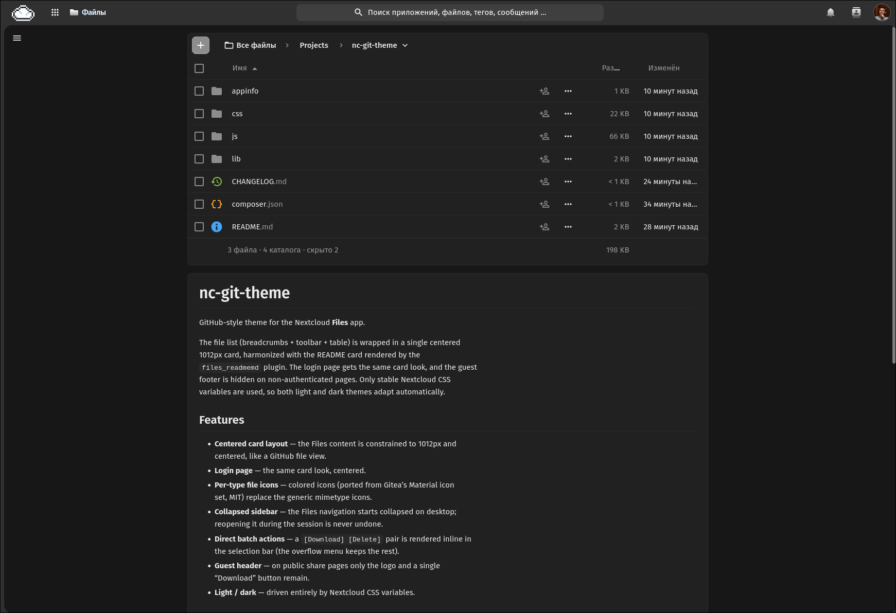

# README.md / HEADER.md viewer for Nextcloud

Show `README.md` and `HEADER.md` (gitlab style) on your Nextcloud directories.

With this app you can add a header and a footer to your Nextcloud folders to explain
their purpose, describe their content, or surface notes for collaborators. The files
are rendered where GitLab shows them: the `HEADER.md` above the file list and the
`README.md` below it.



## Fork notice

This is a maintained fork of [mamatt/files_readmemd](https://github.com/mamatt/files_readmemd)
by Matthieu Le Corre. Since **3.1.0** it targets **Nextcloud 33 & 34** (using the
`@nextcloud/files` v4 file list header API), renders markdown GitHub-style (code block
toolbar, lazy mermaid diagrams, theme-adaptive styling) and is maintained by
[Maksim Totmin](https://github.com/totmin). Versions up to 3.0.2 were released by the
upstream project.

## Features

- Compatible with **Nextcloud 33 & 34**
- GitHub-style rendering: card layout, centered content column, light/dark/high-contrast
  theme support
- GitHub blue links that follow the active Nextcloud theme
- Code blocks get a toolbar with a language label and a copy button
- **Mermaid** diagrams render lazily as you approach them, follow the Nextcloud palette
  and fall back to the source on parse errors
- KaTeX math, tables of contents, task lists, anchors, emoji, image sizing and figures
- Renders in private folders and **public shares**
- Hidden dot files supported (e.g. `.README.md`, `.HEADER.md`)

## Requirements

| Component            | Version                          |
|----------------------|----------------------------------|
| Nextcloud            | 33 or 34                         |
| Node.js (to build)   | >= 20.5.1                        |
| npm (to build)       | >= 10.8.1                        |

The build step only matters if you install from source (see below). The app itself runs
on any Nextcloud 33/34 instance.

## Installation (from source)

Clone the repository into your Nextcloud `apps-extra` (or `apps`) directory and build
the frontend bundle:

```bash
cd /path/to/nextcloud/apps-extra
git clone https://github.com/totmin/files_readmemd.git files_readmemd
cd files_readmemd
npm ci
npm run build
```

Then enable the app from the Nextcloud Apps management page (or with
`occ app:enable files_readmemd`). The frontend is served from the built `js/` folder,
so the build must be run before first use.

## Build / Development

```bash
npm run watch   # rebuild on change during development
npm run build    # production build into js/
make package     # produce files_readmemd.tar.gz for distribution
```

The `Makefile` packages the app (source + built `js/`) into a tarball that can be
uploaded to a Nextcloud instance or submitted to the App Store.

## Usage

- Create a `README.md` file (the name is **case sensitive**) with your Markdown content
  to show it below the file list.
- Do the same with a `HEADER.md` file to show it above the file list.
- You can hide those files by prefixing them with a dot: `.README.md` / `.HEADER.md`.
- Files can also use the `.markdown` extension.
- It renders in **public shares** as well.
- Markdown produced by the Nextcloud Text app is supported.

## Supported Markdown

The following extensions are enabled:

| Feature              | Package                                                        |
|----------------------|---------------------------------------------------------------|
| Image sizing         | [markdown-it-imsize](https://www.npmjs.com/package/markdown-it-imsize) |
| Image figures        | [markdown-it-image-figures](https://www.npmjs.com/package/markdown-it-image-figures) |
| Task lists           | [markdown-it-task-lists](https://www.npmjs.com/package/markdown-it-task-lists) |
| Syntax highlighting  | [markdown-it-highlightjs](https://www.npmjs.com/package/markdown-it-highlightjs) |
| Math (KaTeX)         | [@vscode/markdown-it-katex](https://www.npmjs.com/package/@vscode/markdown-it-katex) |
| Emoji                | [markdown-it-emoji](https://www.npmjs.com/package/markdown-it-emoji) |
| Headings anchors     | [markdown-it-anchor](https://www.npmjs.com/package/markdown-it-anchor) |
| Table of contents    | [markdown-it-toc-done-right](https://www.npmjs.com/package/markdown-it-toc-done-right) |
| Callouts             | [markdown-it-container](https://www.npmjs.com/package/markdown-it-container) |
| Link rewriting       | [markdown-it-replace-link](https://www.npmjs.com/package/markdown-it-replace-link) |
| Diagrams (Mermaid)   | [mermaid](https://www.npmjs.com/package/mermaid) — rendered lazily, not as a markdown-it plugin |

Need another extension? [Open an issue](https://github.com/totmin/files_readmemd/issues).

## Admin settings

In the Nextcloud admin settings you can:

- Choose which filenames are used for the header and footer content (default `HEADER`
  and `README`). Both bare basenames and full filenames (e.g. `README.md`,
  `.README.markdown`) are accepted, including dot-prefixed hidden files.
- Enable the **HTML** and **AsciiDoc** rendering engines (both **disabled by default**;
  Markdown is always available).
- Only administrators can change these settings.

## Related

- [nc-git-theme](https://github.com/totmin/nc-git-theme) — a Git/GitHub-style theme
  for Nextcloud that complements the GitHub-like rendering of this app. The screenshot
  above is taken with it enabled.

## Credits

- [Matthieu Le Corre](https://github.com/mamatt) — original author (up to 3.0.2)
- [Maksim Totmin](https://github.com/totmin) — maintainer of this fork (3.1.0+)

Licensed under [AGPL-3.0](LICENSE).
